# Hero names

Idle pictures are in `idle-cards/`. Open `idle-cards/index.html` to save them. Each card is the sprite already in the game, with the name and level on it.

Every form of a class uses the shared list. Ascension names are in their own list. Do not mix them.

Every class also has Strike and Defend. Those two are not in the lists below. Make them on each body.

## Warrior

Copy these. Every form of this class.

```
Rend
Slash
Power Strike
Whirlwind
Crescent Wave
Shoulder Check
Execution
Riposte Stance
Leaping Cleave
Dragon Slash
Sunder
Battle Trance
Momentum
```

Same list, with the level, so the sheet can be labeled.

- Lv 1 Rend
- Lv 1 Slash
- Lv 1 Power Strike — ultimate
- Lv 3 Whirlwind
- Lv 6 Crescent Wave
- Lv 9 Shoulder Check
- Lv 12 Execution
- Lv 15 Riposte Stance
- Lv 18 Leaping Cleave
- Lv 20 Dragon Slash — ultimate
- Lv 21 Sunder
- Lv 24 Battle Trance
- Lv 27 Momentum

Class ability. Every form. The + and II versions use this same picture unless you split them.

```
Double Strike
```

Ascension skills. One body each.

```
Blood Rage
Holy Judgment
Thousand Cuts
```

- Blood Rage — Berserker only
- Holy Judgment — Paladin only
- Thousand Cuts — Duelist only

Ascension class abilities. One body each. Not the same as the skill above.

```
Blood Frenzy
Flurry of Blades
Oath of Protection
```

- Blood Frenzy — Berserker only
- Flurry of Blades — Duelist only
- Oath of Protection — Paladin only

Idle cards

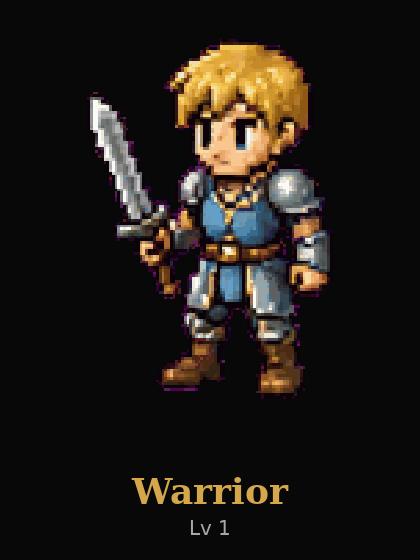

Warrior — Lv 1

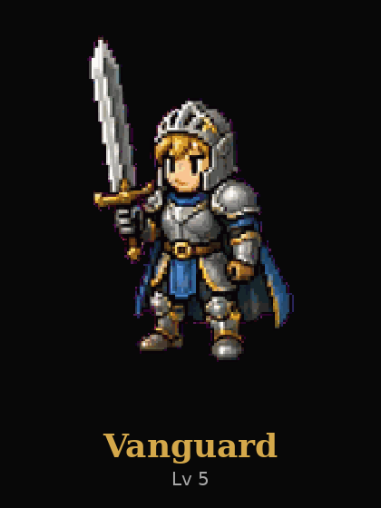

Vanguard — Lv 5

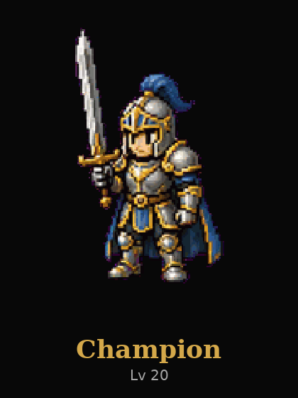

Champion — Lv 20

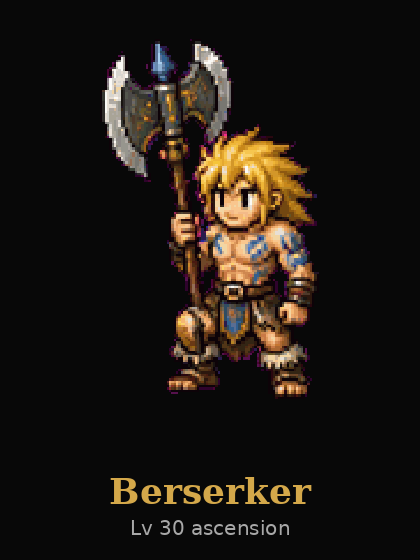

Berserker — Lv 30 ascension

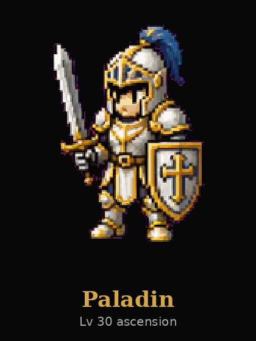

Paladin — Lv 30 ascension


Duelist — Lv 30 ascension

## Tank

Copy these. Every form of this class.

```
Bash
Shield Bash
Crushing Blow
Ground Pound
Ironhide
Hook Chain
Bodyguard
Fortress Slam
Iron Shell
Titan's Wrath
Taunting Roar
Aftershock
Unstoppable
```

Same list, with the level, so the sheet can be labeled.

- Lv 1 Bash
- Lv 1 Shield Bash
- Lv 1 Crushing Blow — ultimate
- Lv 3 Ground Pound
- Lv 6 Ironhide
- Lv 9 Hook Chain
- Lv 12 Bodyguard
- Lv 15 Fortress Slam
- Lv 18 Iron Shell
- Lv 20 Titan's Wrath — ultimate
- Lv 21 Taunting Roar
- Lv 24 Aftershock
- Lv 27 Unstoppable

Class ability. Every form. The + and II versions use this same picture unless you split them.

```
Iron Maiden
```

Ascension skills. One body each.

```
Bulwark
Earthshatter
War Cry
```

- Bulwark — Guardian only
- Earthshatter — Juggernaut only
- War Cry — Warlord only

Ascension class abilities. One body each. Not the same as the skill above.

```
Frost Bulwark
Unbroken Maiden
War Banner
```

- Frost Bulwark — Guardian only
- Unbroken Maiden — Juggernaut only
- War Banner — Warlord only

Idle cards

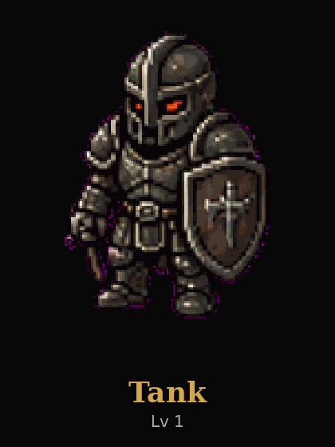

Tank — Lv 1

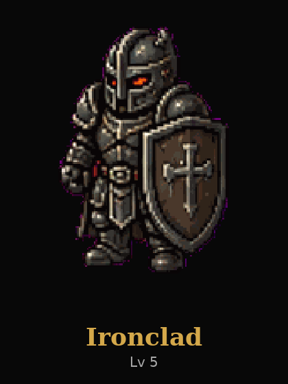

Ironclad — Lv 5

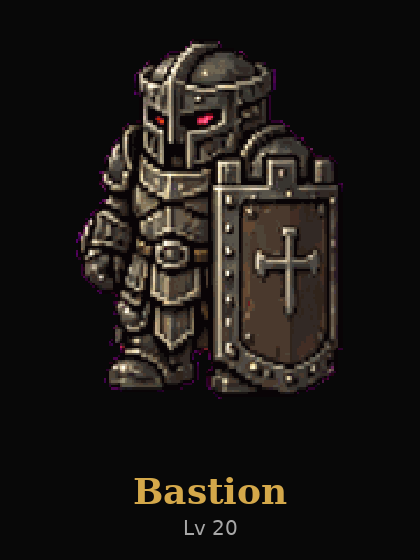

Bastion — Lv 20

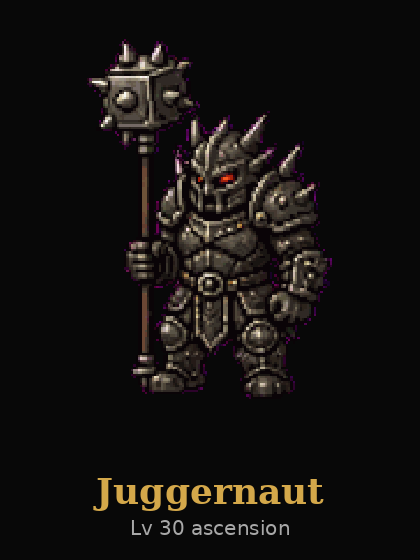

Juggernaut — Lv 30 ascension

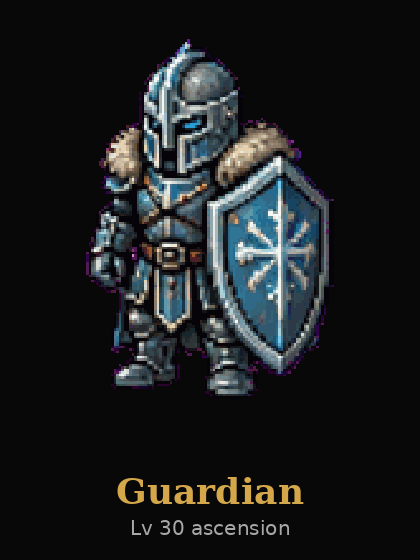

Guardian — Lv 30 ascension

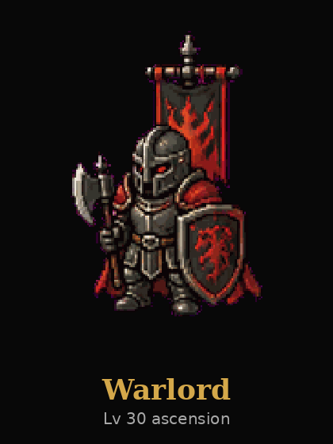

Warlord — Lv 30 ascension

## Mage

Copy these. Every form of this class.

```
Fireball
Frost Bolt
Meteor
Thunder
Ice Lance
Chain Lightning
Blizzard
Blink
Mana Burn
Arcane Nova
Static Field
Gravity Well
Echo
```

Same list, with the level, so the sheet can be labeled.

- Lv 1 Fireball
- Lv 1 Frost Bolt
- Lv 1 Meteor — ultimate
- Lv 3 Thunder
- Lv 6 Ice Lance
- Lv 9 Chain Lightning
- Lv 12 Blizzard
- Lv 15 Blink
- Lv 18 Mana Burn
- Lv 20 Arcane Nova — ultimate
- Lv 21 Static Field
- Lv 24 Gravity Well
- Lv 27 Echo

Class ability. Every form. The + and II versions use this same picture unless you split them.

```
Inner Element
```

Ascension skills. One body each.

```
Absolute Zero
Inferno
Thunderstorm
```

- Absolute Zero — Cryomancer only
- Inferno — Pyromancer only
- Thunderstorm — Stormcaller only

Ascension class abilities. One body each. Not the same as the skill above.

```
Absolute Freeze
Firestorm Field
Elemental Overload
```

- Absolute Freeze — Cryomancer only
- Firestorm Field — Pyromancer only
- Elemental Overload — Stormcaller only

Idle cards


Mage — Lv 1


Sorcerer — Lv 5


Archmage — Lv 20


Pyromancer — Lv 30 ascension


Cryomancer — Lv 30 ascension


Stormcaller — Lv 30 ascension

## Healer

Copy these. Every form of this class.

```
Heal Ally
Mend Self
Divine Grace
Radiant Burst
Blessing
Cleanse
Holy Siphon
Mass Heal
Prism Aura
Last Light
Sacred Flame
Resurrection
Renewal
```

Same list, with the level, so the sheet can be labeled.

- Lv 1 Heal Ally
- Lv 1 Mend Self
- Lv 1 Divine Grace — ultimate
- Lv 3 Radiant Burst
- Lv 6 Blessing
- Lv 9 Cleanse
- Lv 12 Holy Siphon
- Lv 15 Mass Heal
- Lv 18 Prism Aura
- Lv 20 Last Light — ultimate
- Lv 21 Sacred Flame
- Lv 24 Resurrection
- Lv 27 Renewal

Class ability. Every form. The + and II versions use this same picture unless you split them.

```
Enlightenment
```

Ascension skills. One body each.

```
Pandemic
Sanctuary
Time Warp
```

- Pandemic — Plague Doctor only
- Sanctuary — Saint only
- Time Warp — Oracle only

Ascension class abilities. One body each. Not the same as the skill above.

```
Time Shift
Plague Bloom
Divine Choir
```

- Time Shift — Oracle only
- Plague Bloom — Plague Doctor only
- Divine Choir — Saint only

Idle cards


Healer — Lv 1


Cleric — Lv 5


High Priest — Lv 20


Saint — Lv 30 ascension


Oracle — Lv 30 ascension


Plague Doctor — Lv 30 ascension

## Ranger

Copy these. Every form of this class.

```
Shot
Snaring Shot
Power Shot
Multishot
Poison Arrow
Pinning Shot
Piercing Shot
Steady Aim
Disengage
Rain of Arrows
Hunter's Mark
Concussive Arrow
Flaming Volley
```

Same list, with the level, so the sheet can be labeled.

- Lv 1 Shot
- Lv 1 Snaring Shot
- Lv 1 Power Shot — ultimate
- Lv 3 Multishot
- Lv 6 Poison Arrow
- Lv 9 Pinning Shot
- Lv 12 Piercing Shot
- Lv 15 Steady Aim
- Lv 18 Disengage
- Lv 20 Rain of Arrows — ultimate
- Lv 21 Hunter's Mark
- Lv 24 Concussive Arrow
- Lv 27 Flaming Volley

Class ability. Every form. The + and II versions use this same picture unless you split them.

```
Hunter's Eye
```

Ascension skills. One body each.

```
Deadeye
Gale Volley
Snare Field
```

- Deadeye — Sniper only
- Gale Volley — Tempest Archer only
- Snare Field — Trapper only

Ascension class abilities. One body each. Not the same as the skill above.

```
Deadeye Focus
Storm Eye
Snare Field
```

- Deadeye Focus — Sniper only
- Storm Eye — Tempest Archer only
- Snare Field — Trapper only

Idle cards


Ranger — Lv 1


Hunter — Lv 5

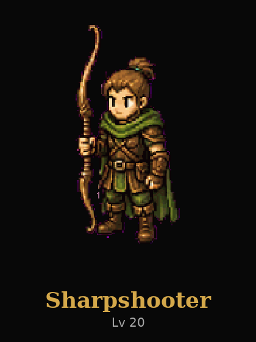

Sharpshooter — Lv 20

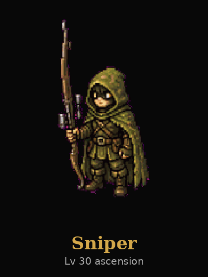

Sniper — Lv 30 ascension


Trapper — Lv 30 ascension

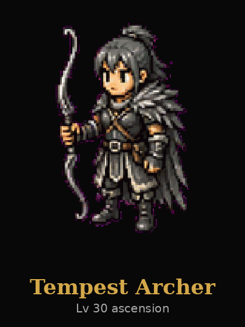

Tempest Archer — Lv 30 ascension

## Assassin

Copy these. Every form of this class.

```
Stab
Venom Edge
Assassinate
Ambush
Fan of Knives
Shadowstep
Smoke Bomb
Garrote
Bait and Switch
Death Blossom
Crippling Cut
Open Veins
Twin Fangs
```

Same list, with the level, so the sheet can be labeled.

- Lv 1 Stab
- Lv 1 Venom Edge
- Lv 1 Assassinate — ultimate
- Lv 3 Ambush
- Lv 6 Fan of Knives
- Lv 9 Shadowstep
- Lv 12 Smoke Bomb
- Lv 15 Garrote
- Lv 18 Bait and Switch
- Lv 20 Death Blossom — ultimate
- Lv 21 Crippling Cut
- Lv 24 Open Veins
- Lv 27 Twin Fangs

Class ability. Every form. The + and II versions use this same picture unless you split them.

```
Bloodlust
```

Ascension skills. One body each.

```
Crimson Waltz
Phantom Rush
Venom Storm
```

- Crimson Waltz — Blade Dancer only
- Phantom Rush — Phantom only
- Venom Storm — Viper only

Ascension class abilities. One body each. Not the same as the skill above.

```
Crimson Bloodlust
Shadow Clones
Death Mark
```

- Crimson Bloodlust — Blade Dancer only
- Shadow Clones — Phantom only
- Death Mark — Viper only

Idle cards

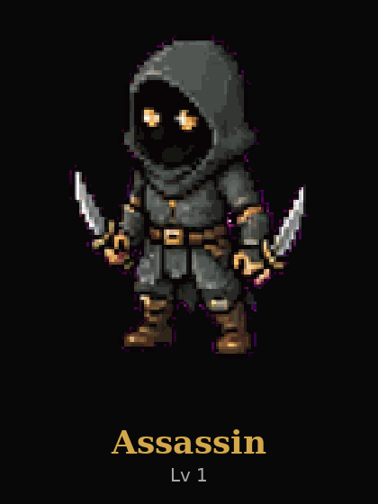

Assassin — Lv 1

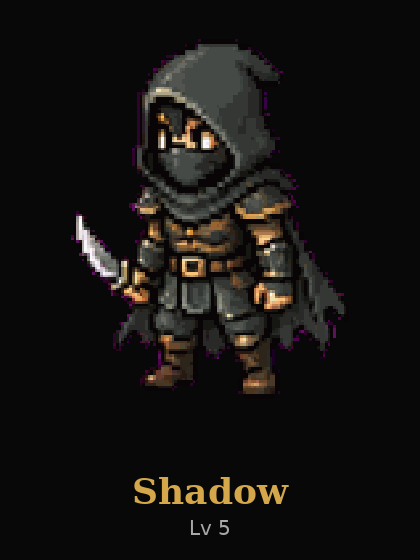

Shadow — Lv 5

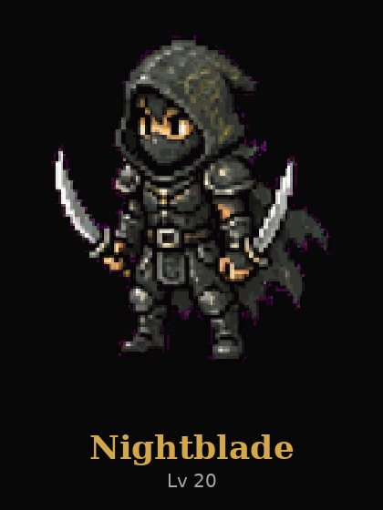

Nightblade — Lv 20


Phantom — Lv 30 ascension


Viper — Lv 30 ascension

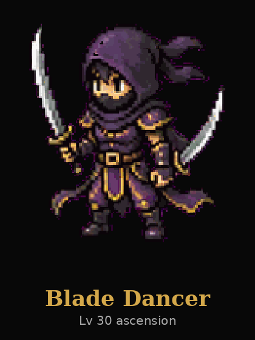

Blade Dancer — Lv 30 ascension

## Gunslinger

Copy these. Every form of this class.

```
Double Tap
Quick Shot
Hollow Point
Ricochet
Flash Bang
Scatter Shot
Boot Shot
Disarming Shot
Roll Out
Bullet Hell
Powder Keg
Lucky Coin
High Noon
```

Same list, with the level, so the sheet can be labeled.

- Lv 1 Double Tap
- Lv 1 Quick Shot
- Lv 1 Hollow Point — ultimate
- Lv 3 Ricochet
- Lv 6 Flash Bang
- Lv 9 Scatter Shot
- Lv 12 Boot Shot
- Lv 15 Disarming Shot
- Lv 18 Roll Out
- Lv 20 Bullet Hell — ultimate
- Lv 21 Powder Keg
- Lv 24 Lucky Coin
- Lv 27 High Noon

Class ability. Every form. The + and II versions use this same picture unless you split them.

```
Quick Draw
```

Ascension skills. One body each.

```
Dead or Alive
Ricochet Storm
Six Shooter
```

- Dead or Alive — Bounty Hunter only
- Ricochet Storm — Trickshot only
- Six Shooter — Outlaw only

Ascension class abilities. One body each. Not the same as the skill above.

```
Wanted Poster
Dead Man's Hand
Overwatch
```

- Wanted Poster — Bounty Hunter only
- Dead Man's Hand — Outlaw only
- Overwatch — Trickshot only

Idle cards


Gunslinger — Lv 1


Desperado — Lv 5


Gunmaster — Lv 20

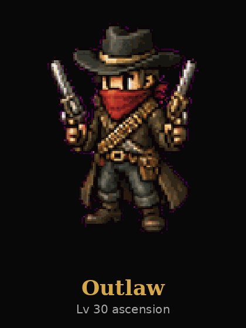

Outlaw — Lv 30 ascension


Bounty Hunter — Lv 30 ascension


Trickshot — Lv 30 ascension

## Knight

Copy these. Every form of this class.

```
Charge
Lance Strike
Grand Charge
Lance Break
Running Thrust
Valor
Trample
Shield of Faith
Unhorse
Cavalry Breaker
Lance Wall
Rescue
Relentless Charge
```

Same list, with the level, so the sheet can be labeled.

- Lv 1 Charge
- Lv 1 Lance Strike
- Lv 1 Grand Charge — ultimate
- Lv 3 Lance Break
- Lv 6 Running Thrust
- Lv 9 Valor
- Lv 12 Trample
- Lv 15 Shield of Faith
- Lv 18 Unhorse
- Lv 20 Cavalry Breaker — ultimate
- Lv 21 Lance Wall
- Lv 24 Rescue
- Lv 27 Relentless Charge

Class ability. Every form. The + and II versions use this same picture unless you split them.

```
Vow of Honor
```

Ascension skills. One body each.

```
Crusade
Doom Lance
Lightning Charge
```

- Crusade — Templar only
- Doom Lance — Black Knight only
- Lightning Charge — Storm Rider only

Ascension class abilities. One body each. Not the same as the skill above.

```
Oath of Ruin
Thunderous Oath
Sacred Vow
```

- Oath of Ruin — Black Knight only
- Thunderous Oath — Storm Rider only
- Sacred Vow — Templar only

Idle cards

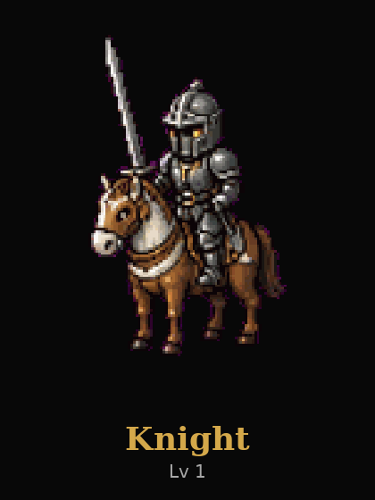

Knight — Lv 1

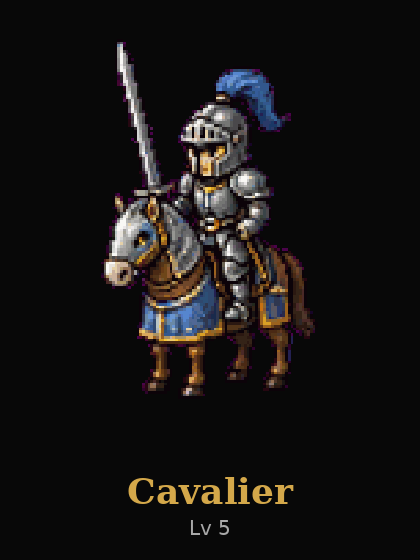

Cavalier — Lv 5

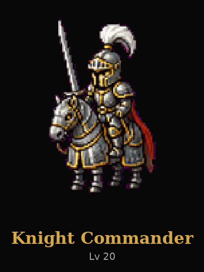

Knight Commander — Lv 20

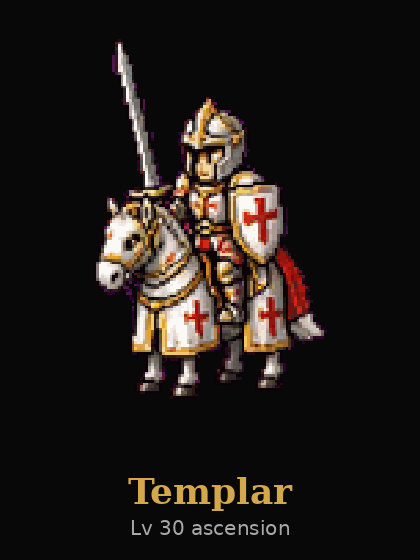

Templar — Lv 30 ascension

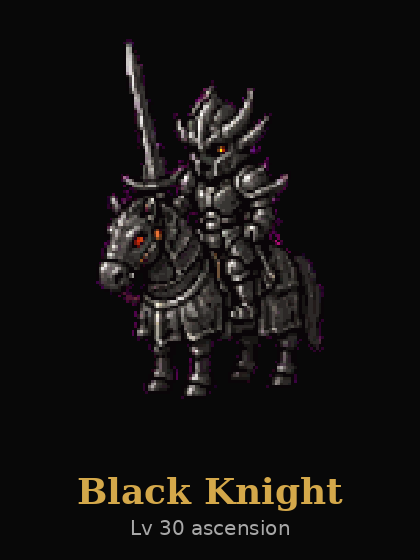

Black Knight — Lv 30 ascension

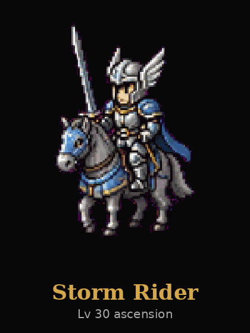

Storm Rider — Lv 30 ascension

## Dragon Knight

Copy these. Every form of this class.

```
Dragon Claw
Spear Thrust
Impale
Dragonfire
Wing Gust
Sky Dive
Tail Sweep
Dragon Scales
Wyrm Roar
Dragon's Fury
Ember Trail
Skewer
Wyrmbond
```

Same list, with the level, so the sheet can be labeled.

- Lv 1 Dragon Claw
- Lv 1 Spear Thrust
- Lv 1 Impale — ultimate
- Lv 3 Dragonfire
- Lv 6 Wing Gust
- Lv 9 Sky Dive
- Lv 12 Tail Sweep
- Lv 15 Dragon Scales
- Lv 18 Wyrm Roar
- Lv 20 Dragon's Fury — ultimate
- Lv 21 Ember Trail
- Lv 24 Skewer
- Lv 27 Wyrmbond

Class ability. Every form. The + and II versions use this same picture unless you split them.

```
Beast Mode
```

Ascension skills. One body each.

```
Glacial Breath
Hellfire Dive
Thunder Lance
```

- Glacial Breath — Frost Wyrm only
- Hellfire Dive — Inferno Rider only
- Thunder Lance — Storm Dragoon only

Ascension class abilities. One body each. Not the same as the skill above.

```
Glacial Scales
Inferno Beast
Sky Lord
```

- Glacial Scales — Frost Wyrm only
- Inferno Beast — Inferno Rider only
- Sky Lord — Storm Dragoon only

Idle cards

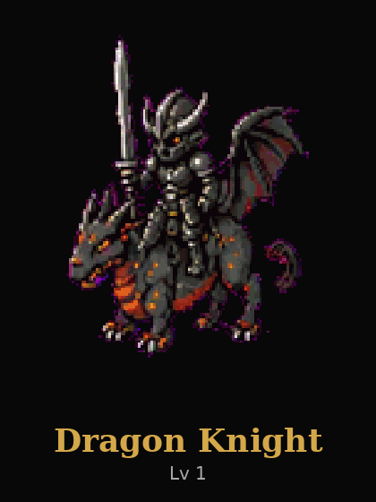

Dragon Knight — Lv 1

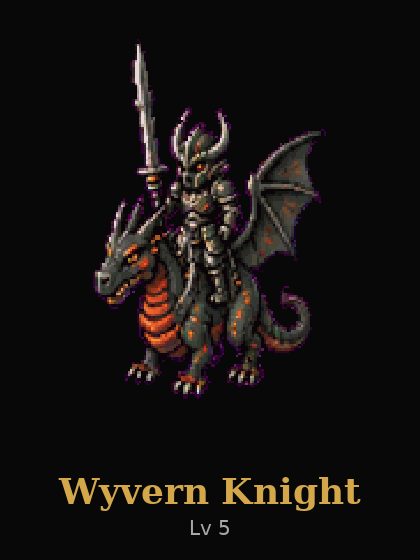

Wyvern Knight — Lv 5

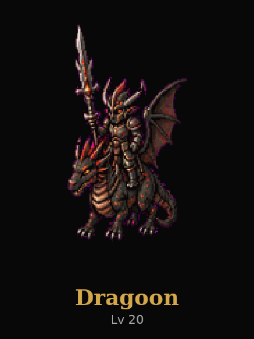

Dragoon — Lv 20

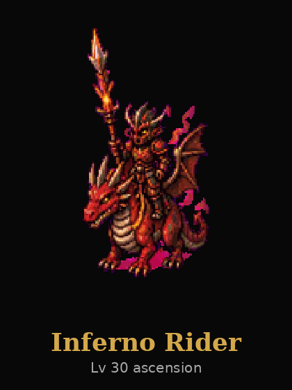

Inferno Rider — Lv 30 ascension

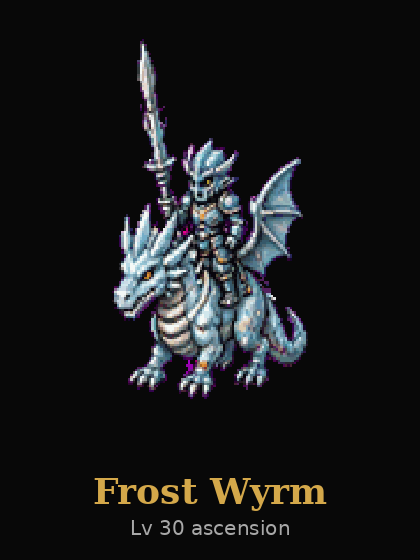

Frost Wyrm — Lv 30 ascension

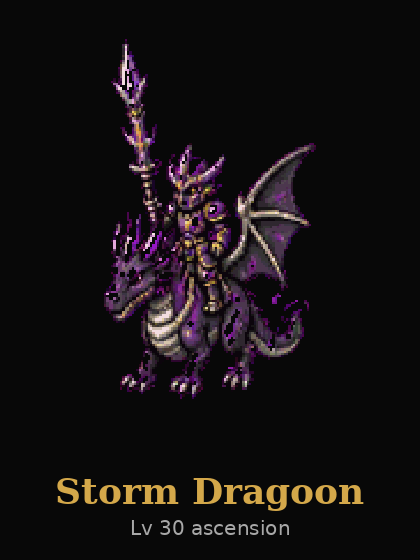

Storm Dragoon — Lv 30 ascension

## Witch

Copy these. Every form of this class.

```
Hex
Toxic Bolt
Witch's Brew
Miasma
Curse of Frailty
Plague Swarm
Voodoo Link
Wither
Puppet Strings
Hex Storm
Soul Siphon
Contagion
Bog of Despair
```

Same list, with the level, so the sheet can be labeled.

- Lv 1 Hex
- Lv 1 Toxic Bolt
- Lv 1 Witch's Brew — ultimate
- Lv 3 Miasma
- Lv 6 Curse of Frailty
- Lv 9 Plague Swarm
- Lv 12 Voodoo Link
- Lv 15 Wither
- Lv 18 Puppet Strings
- Lv 20 Hex Storm — ultimate
- Lv 21 Soul Siphon
- Lv 24 Contagion
- Lv 27 Bog of Despair

Class ability. Every form. The + and II versions use this same picture unless you split them.

```
Poison Ivy
```

Ascension skills. One body each.

```
Blood Moon
Grand Hex
Soul Nova
```

- Blood Moon — Blood Witch only
- Grand Hex — Hex Queen only
- Soul Nova — Necromancer only

Ascension class abilities. One body each. Not the same as the skill above.

```
Blood Pact
Queen's Garden
Grave Bloom
```

- Blood Pact — Blood Witch only
- Queen's Garden — Hex Queen only
- Grave Bloom — Necromancer only

Idle cards


Witch — Lv 1


Hexer — Lv 5


Coven Mistress — Lv 20


Necromancer — Lv 30 ascension

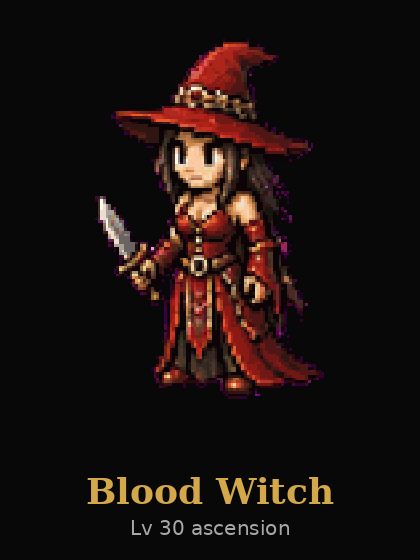

Blood Witch — Lv 30 ascension


Hex Queen — Lv 30 ascension

